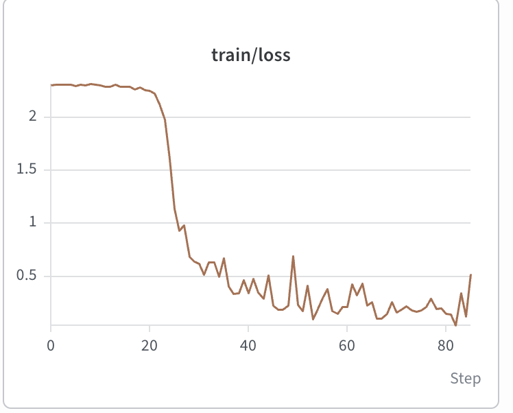
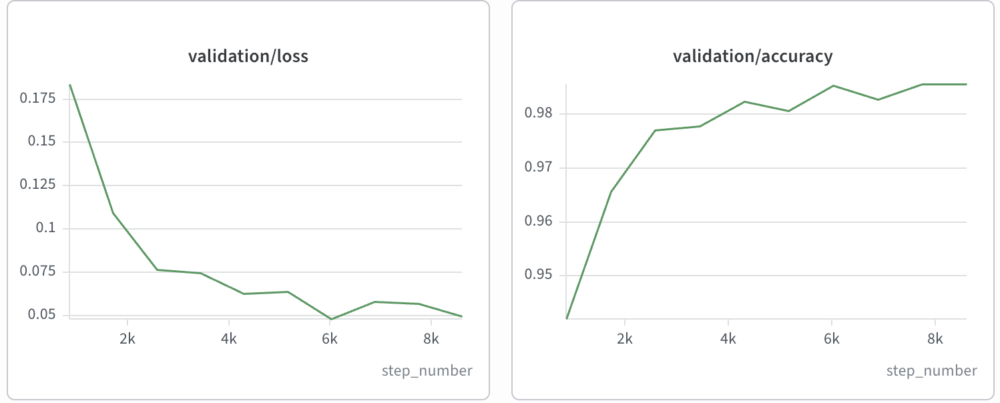
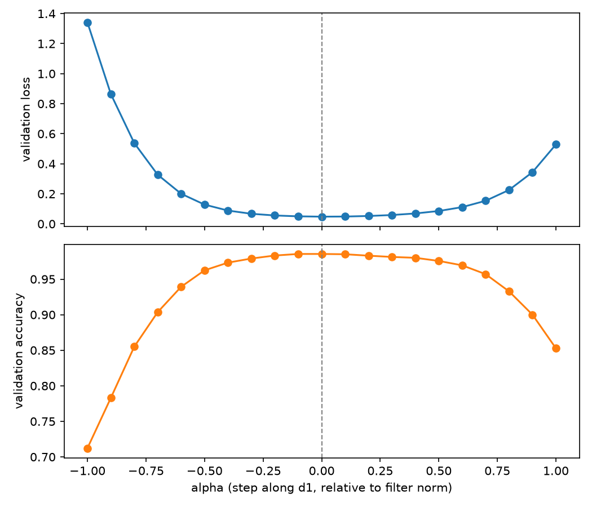
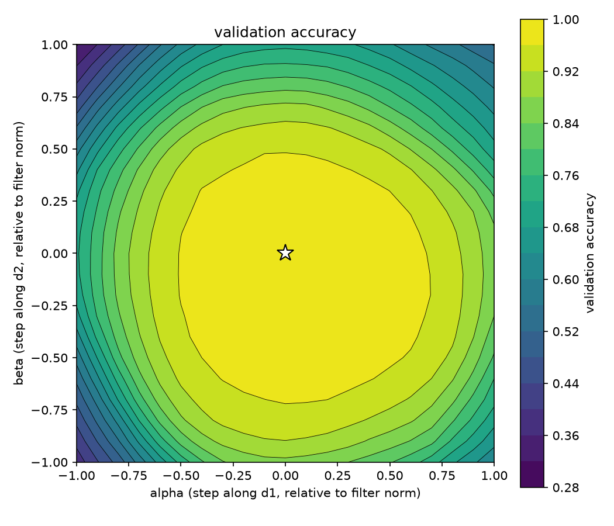
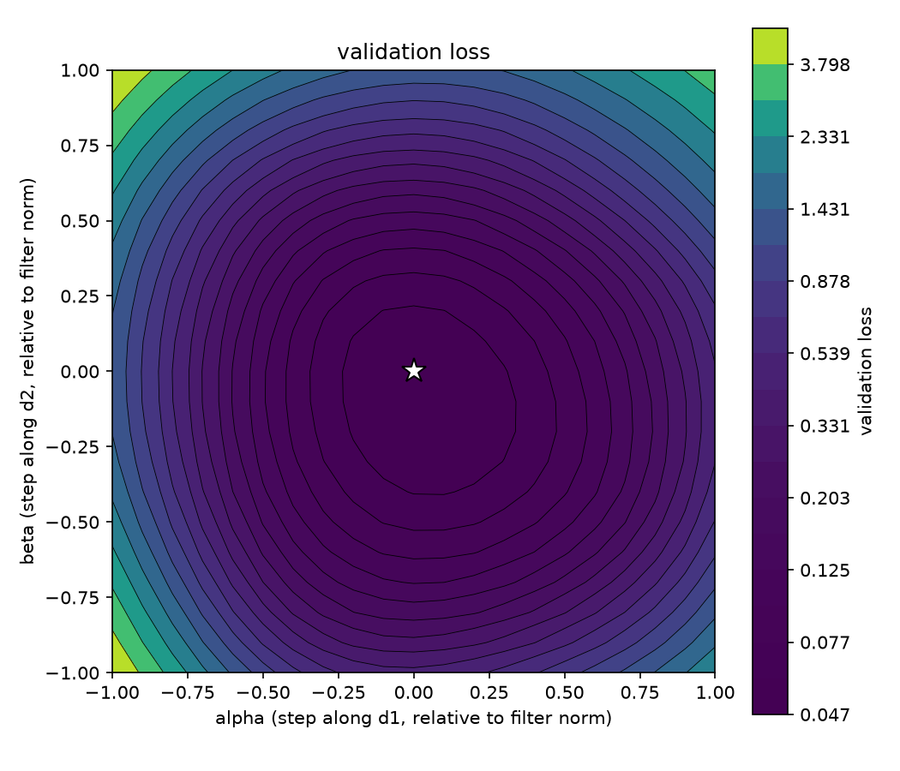
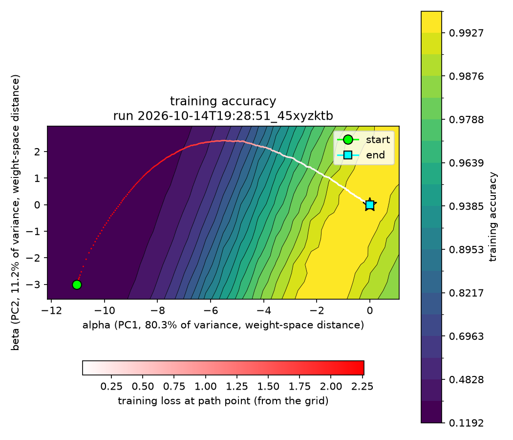
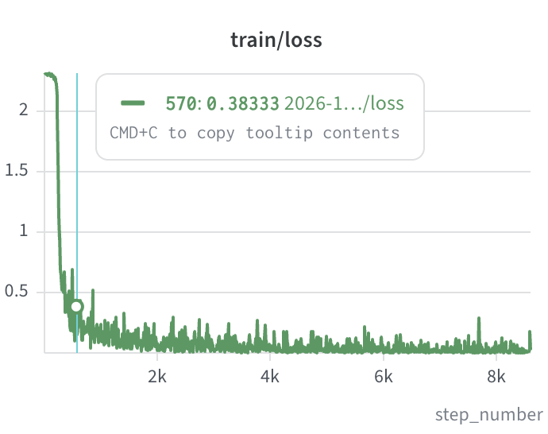

# MNIST handwritten digit reimplementation

- [x] Set up Hugging Face data ingest + W&B logging
- [x] Set up train loop
- [x] Set up validation loop 
- [x] Set up test loop
- [x] Visualize loss landscape

## Things I learned

(and/or did not think about the last time I implemented something like this in ~2017)

- Thinking a lot more about types and truly understanding the matrix math. I spend much more time thinking about types. Pytorch type stubs are pretty bad
- Lazy loading, CPU/GPU data transfer somewhat nonintuitive; dataset is probably still too small to see actual differences here
- W&B is nice for plotting/logging
- Role of AI - I basically went back to 2023 in some ways, not allowing the AI to write code for me unless it was generic stuff I don't really care about (like matplotlib libraries, which I sped through ie letting a second agent rip while I was asking a main agent questions). But better since it knows my context, can read the other reference repo, etc.

## Log

I started out with a goal:
- Build understanding and intuition of a problem
- Learn how to use modern tooling
- Build the skill of asking interesting questions and answering them

Using the handwritten digit classification task on MNIST as a testbed.

### Oct 7

Set up Hugging Face, Weights & Biases, ipynb workflow.

### Oct 8

Laid out the LeNet5 model architecture from the paper.

Spent a while refreshing my memory on each operation and what it does to the activation dimensions and parameter count (convolution, flatten, fully connected layers).

### Oct 9

Added typechecking, data loaders, config infra, randomness seeds.

Spent a while on types to make sure I have everything straight on my data preparation:
- The Hugging Face `dataset` library's `Dataset` type vs. the PyTorch library's `Dataset` type.
  - I ended up aliasing them `ArrowDataset` and `TorchDataset` respectively for clarity and somewhat giving up on typing, just doing a `cast()` instead. They implement the same `__len__` and `__getitem__` so this is fine anyway. Not worth being super precise.
- I did want to document the type of the HF dataset entries, hence the `InputDatasetItem`.
- I lazyload the dataset to build a good habit even though MNIST fits in memory.
    - Given this - where does the input transform live, since the images are 0-255 ints, and we want them to be floats? I end up using PyTorch's `collate`. `set_transform` belongs to HF but I would rather work more in PyTorch
- While digging through and justifying each line, Claude suggests I normalize the inputs to the mean, and points me to [Efficient Backprop (LeCun et al, 1998)](https://cseweb.ucsd.edu/classes/wi08/cse253/Handouts/lecun-98b.pdf) section 4.3: Normalizing the Inputs. I'm intentionally leaving it out just to see what would happen later. Maybe later I'll also experiment with different hyperparameters like the filter sizes, nonlinearity functions, etc.
- However, I also learned about the "modern" movement toward fiddling less with the exact hyperparameters and trusting the process more, which is simultaneously cool and somewhat maddening that it can be so hands-off. In the original paper, the very specific pattern to the S2-C3 connections ([Gradient-Based Learning Applied to Document Recognition (LeCun et al, 1998)](http://yann.lecun.com/exdb/publis/pdf/lecun-98.pdf) section II.B: LeNet5) is rationalized as keeping parameter count down and forcing different features to be learned, which I completely discard as a simplification for now.

### Oct 12

Started doing training. Got my first loss graph logged in W&B; this is a single epoch.

That early plateau is interesting to me, and maybe points to the inefficiency of using a nonoptimal start from not normalizing the input data. Although this is just one seed.

Also did multiple epochs.

### Oct 13

Started using my validation and test sets and producing plots for validation loss and validation accuracy.

Ran into a few bugs calculating accuracy because I insisted on understanding it myself. Here is where the dimension-level reasoning/typing (`[B, 1, 28, 28]`) was very helpful in debugging, since this was mostly me taking the length of incorrect things. Claude was pretty good at pointing out where I was going wrong.

Out-of-the-box it works decently already, I think? Reached 98.56% validation accuracy, although the differences might be compressed at this scale, where getting to the next 0.5%, 0.25%, etc. gets exponentially harder and harder.

At least the plots aren't showing signs of overfitting, which would look like train loss going down but validation loss staying static if I understand correctly:

At some point I'll set up [type stubs](https://github.com/pytorch/pytorch/wiki/Guide-for-adding-type-annotations-to-PyTorch). Might help with issues similar to when I was trying to pass around a `loss_fn` which was really just cross-entropy loss. I ended up hardcoding a shared type for it so that I could properly annotate what I was actually doing (`(Tensor, Tensor) -> Tensor`).

### Oct 14

Instead of fiddling with hyperparameters yet, I decided to push forward on this other interesting paper I saw in order to grok what is happening with the trained weights a bit better: [Visualizing the Loss Landscape of Neural Nets (Li et al, 2018)](https://ar5iv.labs.arxiv.org/html/1712.09913).

Also, I wanted to see whether I could watch something more visual than the training loss change while addressing that potential plateau/initialization issue from Oct 12.

#### 1D
The gist of it in 1D (I am changing some notation from the paper to make it slightly clearer IMO):
- Take a trained network's many-dimensional weights $\theta^\star$; this is your (0, 0).
- In some direction vector $\overset{\rightharpoonup}{\alpha}$ normalized relative to the weights, slide along those vectors (parametrized by, say, $u$) and evaluate the network at points along those vectors: $L(\theta^\star + u\overset{\rightharpoonup}{\alpha})$.
  - This direction vector is normalized relative to the filter weights.
- Plot loss vs. $u$.

I got 1D plots working first, which roughly matches the graphs from earlier: validation loss and accuracy peak correctly (at a minimum and a maximum respectively) which is a good sign:

#### 2D

In 2D, this is roughly the same:
- Take a trained network's many-dimensional weights $\theta^\star$; this is your (0, 0).
- In some direction vectors $\overset{\rightharpoonup}{\alpha}$, $\overset{\rightharpoonup}{\beta}$, both normalized relative to the weights, slide along those vectors (parametrized by, say, $u$, $v$) and evaluate the network at points along those vectors: $L(\theta^\star + u\overset{\rightharpoonup}{\alpha} + v\overset{\rightharpoonup}{\beta})$.
- Plot a contour where your x,y position is the $\alpha$, $\beta$ coordinate and color is the value (loss or validation).

The 2D plots with the method of random directions around the best-validation-loss weights. Loss is a bit nicer in that the bands more clearly show the minimum, but probably could have used log-scale for both:

| accuracy | loss |
| --- | --- |
|  |  |

I'm also inspired by Chris Olah's attempts at dimensionality reduction to [visualize the dataset itself (2014).](https://colah.github.io/posts/2014-10-Visualizing-MNIST/)

I planned out the changes to plot the training trajectory.

### Oct 15

Finished the training trajectory plotting with updated color and band-scale so that we get both log-spaced bands and log-spaced contrast.

The algorithm is:
- Snapshot $n$ weights during training.
- Find the 2-dimensional projection that captures the most variation in these $n$ datapoints:
  - Take the PCA and use the top 2 basis vectors.
  - Use this basis $\overset{\rightharpoonup}{\alpha}$, $\overset{\rightharpoonup}{\beta}$ to define the plane, instead of the random ones from the earlier method that just plotted the network weights.
- Center the trajectory on the weights so that it ends at (0,0).
- Use the final training snapshot as $\theta^\star$ for the contour plot. We need to do this because we are using training snapshots for the trajectory points, so another plane would be incorrect, at least relative to the final point.

A few observations:
- This does not quite capture that early training dropoff I was hoping for, and that part of the path cuts across the gradient, probably because of earlier movement in some other dimension.
  - I think it's because we spend ~10 points covering that ground and the remaining ~8000 elsewhere.
- The final network projection is a valley in these particular dimensions instead of the round plots from earlier
  - It's not a zoom issue (as in looking very closely at a side of the bowl only; you can see the other side of the valley at the lower right)
  - It's not an aspect ratio issue (one unit on $x$ is the same size as one unit on $y$ for instance)
  - I think it's because most of the points are on that pink-white arc from $(-6,2)$ -ish to the final destination $(0,0)$, so averaged across all ~8000 points, the path *is* mostly a walk down this valley.
- I am a bit surprised to see that we spend so many steps continuing to walk down this valley; by step ~500 of ~8000 we are already at a loss of less than 0.5. But maybe that's just because I didn't tune learning rate (0.01) or momentum (0.9) at all.

